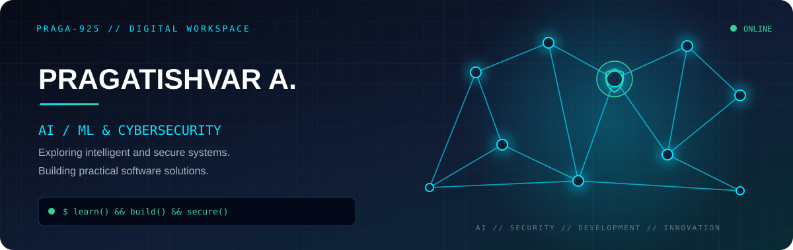
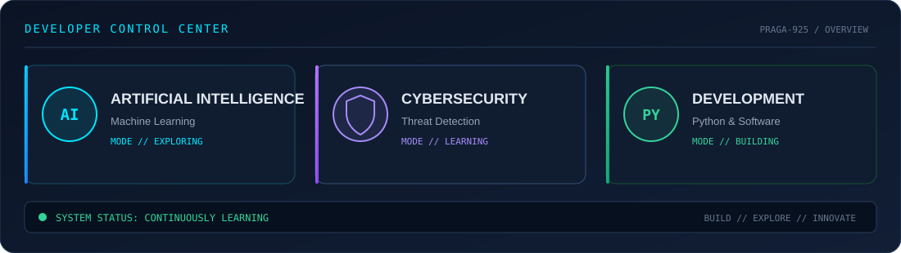

<!-- ========================================================= -->
<!-- PRAGATISHVAR A. | ADVANCED GITHUB PROFILE README           -->
<!-- DESIGN: CYBER DASHBOARD / AI / MACHINE LEARNING            -->
<!-- ========================================================= -->

<!-- CUSTOM HERO -->
<p align="center">
  
</p>

<!-- TYPING INTRO -->
<p align="center">
  
</p>

<!-- CUSTOM DASHBOARD -->
<p align="center">
  
</p>

<!-- ===================== TERMINAL ========================== -->

<table width="100%">
<tr>
<td>

### `> SYSTEM.IDENTITY`

```yaml
name: Pragatishvar A.
username: Praga-925
role: AI/ML & Cybersecurity Enthusiast
education: Computer Science & Engineering

primary_interests:
  - Artificial Intelligence
  - Machine Learning
  - Cybersecurity
  - Threat Detection

development:
  - Python
  - Full-Stack Development
  - Intelligent Applications

currently_exploring:
  - Agentic AI
  - RAG
  - AI-powered Security Systems
```

</td>
</tr>
</table>

<!-- ===================== DASHBOARD ======================== -->

<h2 align="center">◈ DEVELOPER DASHBOARD ◈</h2>

<p align="center">
  
  
  
</p>

<p align="center">
  
  
</p>

<p align="center">
  
</p>

---

<!-- ===================== ABOUT ============================= -->

<h2>◈ ABOUT ME</h2>

<table width="100%">
<tr>
<td width="65%" valign="top">

Hey! I'm **Pragatishvar**, a Computer Science & Engineering student passionate about exploring the intersection of Artificial Intelligence and Cybersecurity.

I enjoy experimenting with machine learning models, developing intelligent applications and exploring how technology can solve practical problems.

**What drives me:**

- 🤖 Building AI and ML-powered applications.
- 🔐 Exploring cybersecurity and threat detection.
- 🐍 Developing Python-based solutions.
- 🌐 Creating useful full-stack applications.
- 🧠 Experimenting with Agentic AI and RAG.
- 🚀 Continuously learning and building projects.

</td>
<td width="35%" align="center" valign="middle">


<br/><br/>

<code>LEARN</code><br/>
<code>BUILD</code><br/>
<code>EXPLORE</code><br/>
<code>INNOVATE</code>

</td>
</tr>
</table>

---

<!-- ===================== TECH STACK ======================= -->

<h2>◈ TECHNOLOGY ARSENAL</h2>

### `01 / PROGRAMMING`

<p>


</p>

### `02 / AI & MACHINE LEARNING`

<p>


</p>

### `03 / CYBERSECURITY`

<p>


</p>

### `04 / DEVELOPMENT & DATABASES`

<p>


</p>

### `05 / DEVELOPER TOOLS`

<p>


</p>

---

<!-- ===================== PROJECTS ========================== -->

<h2>◈ PROJECT SHOWCASE</h2>

<p align="center">
  <sub>SELECTED PROJECTS // EXPERIMENTS // REAL-WORLD APPLICATIONS</sub>
</p>

<table width="100%">
<tr>
<td width="50%" valign="top">

<h3>◉ AI USER MONITORING</h3>


AI-powered user activity monitoring and anomaly detection system using machine learning.

**Stack:** Python · Isolation Forest · Flask · MongoDB

<a href="https://github.com/Praga-925/AI-Powered-User-Monitoring-Anomaly-Detection">VIEW SOURCE ↗</a>

</td>
<td width="50%" valign="top">

<h3>◉ PHISHING DETECTION</h3>


Machine learning-based phishing email classification using natural language processing and XGBoost.

**Stack:** Python · TF-IDF · XGBoost · Streamlit

<a href="https://github.com/Praga-925/Phishing-Email-Detection-using-Machine-Learning">VIEW SOURCE ↗</a>

</td>
</tr>

<tr>
<td width="50%" valign="top">

<h3>◉ eDNA MARINE INTELLIGENCE</h3>


AI-driven marine biodiversity intelligence using environmental DNA concepts.

**Stack:** Python · AI/ML

<a href="https://github.com/Praga-925/eDNA---Marine-Biodiversity-Intelligence-System">VIEW SOURCE ↗</a>

</td>
<td width="50%" valign="top">

<h3>◉ FLOOD MAPPING</h3>


Deep learning-based flood mapping and analysis using satellite imagery.

**Stack:** Python · Deep Learning · Satellite Imagery

<a href="https://github.com/Praga-925/Flood-Mapping-from-Satellite-Imagery-Using-Deep-Learning">VIEW SOURCE ↗</a>

</td>
</tr>

<tr>
<td width="50%" valign="top">

<h3>◉ EMPLOYEE SALARY PREDICTION</h3>


Machine learning-based salary prediction using LightGBM.

**Stack:** Python · LightGBM · Pandas · Streamlit

<a href="https://github.com/Praga-925/Employee-Salary-Prediction-Using-LightGBM-Machine-Learning">VIEW SOURCE ↗</a>

</td>
<td width="50%" valign="top">

<h3>◉ 2D TO 3D RECONSTRUCTION</h3>


Single-image-based 3D reconstruction using the TripoSR project.

**Stack:** Python · PyTorch · Computer Vision

<a href="https://github.com/Praga-925/2D-to-3D-Image-Convert">VIEW SOURCE ↗</a>

</td>
</tr>
</table>

---

<!-- ===================== JOURNEY =========================== -->

<h2>◈ DEVELOPER JOURNEY</h2>

<p align="center">
  
  
  
  
  
</p>

<p align="center">
  <i>From learning fundamentals to building practical intelligent systems.</i>
</p>

---

<!-- ===================== CONTRIBUTIONS ==================== -->

<h2>◈ CONTRIBUTION ACTIVITY</h2>

<p align="center">
  
</p>

---

<!-- ===================== CONTACT =========================== -->

<h2>◈ ESTABLISH CONNECTION</h2>

<p align="center">
  <b>Interested in collaborating, building innovative projects or discussing technology?</b>
  <br/>
  Let's connect.
</p>

<p align="center">
  <a href="https://github.com/Praga-925">
    
  </a>
  <a href="https://www.linkedin.com/in/pragatishvar-a-72b863325/">
    
  </a>
</p>

<p align="center">
  
</p>

<p align="center">
  <code>LEARN(); &nbsp; BUILD(); &nbsp; SECURE(); &nbsp; REPEAT();</code>
</p>

<p align="center">
  <sub>Designed & maintained by Pragatishvar A. | @Praga-925</sub>
</p>
